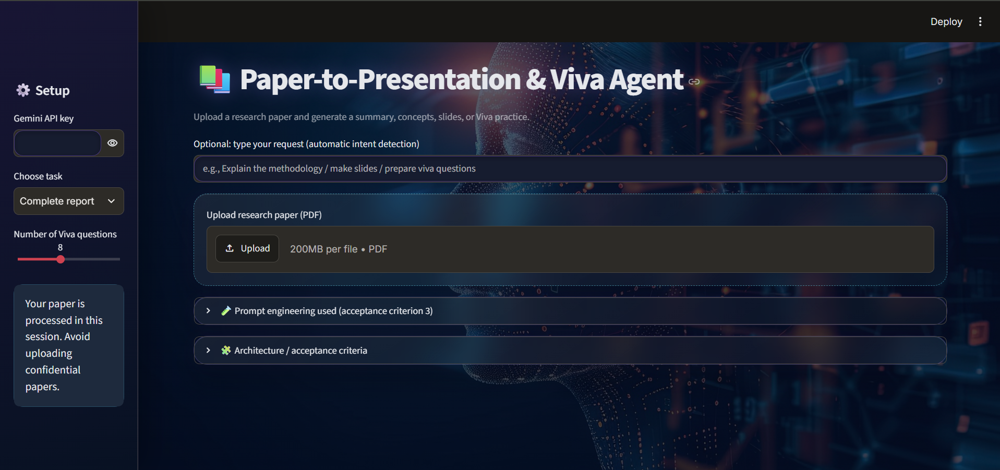

# 📄 Paper-to-Presentation & Viva Agent

### Transform Research Papers into Presentations, Reports and Viva Preparation with AI

An AI-powered application that converts research papers into meaningful summaries, key concepts, presentation slides and viva questions. It uses **Retrieval-Augmented Generation (RAG)** to provide context-aware responses grounded in the uploaded PDF.

## ✨ Features

- **PDF Processing:** Upload and extract text from research papers.
- **AI Summarization:** Generate clear and concise paper summaries.
- **Concept Extraction:** Identify important concepts and technical terms.
- **Presentation Generation:** Create structured presentation slides.
- **Viva Preparation:** Generate relevant viva questions and answers.
- **Ask Your Paper:** Ask questions and receive context-based answers.
- **Complete Report:** Generate a comprehensive report.
- **Multiple Export Formats:** Download outputs as PDF, DOCX and PPTX.
- **Automatic Intent Detection:** Identify the user's request and route it to the appropriate task.

## 🧠 AI Architecture

```text
              User
               |
               v
        Streamlit Interface
               |
               v
          PDF Upload
               |
               v
       Text Extraction
               |
               v
        Text Chunking
               |
               v
       Gemini Embeddings
               |
               v
          ChromaDB
               |
               v
     Similarity Retrieval
               |
               v
       Retrieved Context
               |
               v
       Intent Detection
               |
               v
        AI Task Routing
               |
       +-------+--------+
       |       |        |
    Summary Concepts  Slides
       |       |        |
       +-------+--------+
               |
          Viva / Q&A
               |
               v
        Generated Output
               |
               v
       PDF / DOCX / PPTX
```

## 🛠️ Technology Stack

| Technology | Purpose |
|---|---|
| Python | Backend development |
| Streamlit | User interface |
| Google Gemini | AI-powered generation |
| LangChain | Prompt engineering and LCEL |
| ChromaDB | Vector database |
| PDF Processing | Research paper text extraction |
| ReportLab | PDF export |
| python-docx | DOCX export |
| python-pptx | PPTX export |

## 🔍 RAG Implementation

The application implements a Retrieval-Augmented Generation pipeline:

1. Extracts text from the uploaded PDF.
2. Splits the text into smaller chunks.
3. Generates vector embeddings.
4. Stores embeddings in ChromaDB.
5. Retrieves relevant chunks using similarity search.
6. Passes retrieved context to Gemini to generate grounded responses.

## 🤖 Agentic AI Capabilities

- Intent classification to understand user requests.
- Task routing to the appropriate AI workflow.
- Retrieval decisions based on the requested task.
- Specialized workflows for summarization, concepts, slides, viva and question answering.
- Prompt engineering using zero-shot, few-shot and reflection techniques.

## ⚙️ Installation and Setup

### Prerequisites

- Python 3.10 or later
- Gemini API key
- VS Code (recommended)

### 1. Clone the repository

```bash
git clone YOUR_GITHUB_REPOSITORY_URL
cd Paper-to-Presentation-Viva-Agent
```

### 2. Create and activate a virtual environment

```bash
python -m venv .venv
```

Windows PowerShell:

```powershell
.venv\Scripts\Activate.ps1
```

### 3. Install dependencies

```bash
pip install -r requirements.txt
```

### 4. Run the application

```bash
streamlit run app.py
```

### 5. Use the application

1. Enter your Gemini API key in the sidebar.
2. Upload a text-based research paper PDF.
3. Select a task or enter a natural-language request.
4. Click **Run Agents**.
5. View and export the generated results.

## 📁 Project Structure

```text
Paper-to-Presentation-Viva-Agent/
│
├── app.py
├── pipeline.py
├── export_files.py
├── requirements.txt
├── background.jpg
├── README.md
├── .gitignore
│
└── .venv/  (local environment - not uploaded)
```

## 📤 Output Formats

- PDF – Readable reports and generated content.
- DOCX – Editable Word documents.
- PPTX – Editable PowerPoint presentations.

## ⚠️ Limitations

- Requires a valid Gemini API key.
- Scanned PDFs without selectable text may not work.
- Generated content should be reviewed for accuracy.
- Presentation formatting may require manual refinement.

## 🚀 Future Enhancements

- OCR support for scanned research papers.
- More advanced multi-agent collaboration.
- Improved presentation themes and layouts.
- Additional vector database and LLM options.

## 🎯 Project Objective
## 📸 Project Screenshot




To simplify academic research and presentation preparation through an intelligent AI-powered assistant that transforms research papers into structured, understandable and presentation-ready learning materials.

---

**Developed as an Agentic AI Project**
